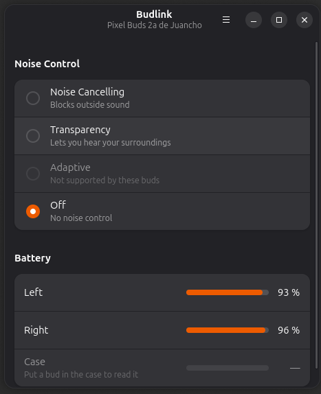
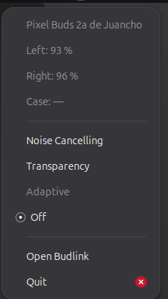

# Budlink

Control your Google Pixel Buds from the Linux desktop: switch noise cancelling modes and check the
battery of each bud and the case. Built with GTK 4 and libadwaita.



> **Status:** early development. Not affiliated with or endorsed by Google.

## Features

- Noise control: Off, Noise Cancelling, Transparency and Adaptive (modes a model rejects are
  greyed out)
- Battery level and charging state for the left bud, right bud and case
- Follows changes made on the buds themselves (touch-and-hold gesture)
- Reconnects on its own when the buds come back
- Panel (tray) icon with battery and noise control, so the window can stay closed. Needs a
  desktop with StatusNotifierItem support: KDE, or GNOME with the AppIndicator extension
  (enabled by default on Ubuntu). Without it, closing the window quits the app.

- English and Spanish, selectable in Preferences (follows the system language by default)
- Light or dark style, selectable in Preferences (follows the system setting by default)



## Supported devices

Budlink talks to the buds over Google's Maestro protocol, using
[`libmaestro`](https://github.com/qzed/pbpctrl) by Maximilian Luz.

| Device | Status |
|---|---|
| Pixel Buds 2a | Tested (no Adaptive mode: the buds reject it) |
| Pixel Buds Pro | Expected to work (supported by `libmaestro`), not tested yet |
| Pixel Buds Pro 2 | Untested |

If you try it with another model, please open an issue with the result.

## Getting Budlink

Budlink is available on GitHub, at
[github.com/neptunonet/budlink](https://github.com/neptunonet/budlink). There are no prebuilt
packages yet (a Flathub release is in the works), so get the source and build it in one of two
ways:

```sh
git clone https://github.com/neptunonet/budlink.git
cd budlink
```

- **Flatpak** (recommended, works on any distribution): see [Flatpak](#flatpak) below.
- **Native build** with `cargo`, installed in `~/.local`: see the next steps.

## Building

Dependencies on Debian/Ubuntu:

```sh
sudo apt install cargo libgtk-4-dev libadwaita-1-dev libdbus-1-dev pkg-config protobuf-compiler
```

Requires Rust 1.92+, GTK 4 and libadwaita 1.7+. Then:

```sh
cargo build --release
./target/release/budlink
```

To install it for your user, with its menu entry and icon (in `~/.local`):

```sh
./install.sh
```

`./install.sh --uninstall` removes it again.

### Flatpak

The manifest is [`io.github.neptunonet.Budlink.json`](io.github.neptunonet.Budlink.json). It
builds on the GNOME 51 runtime with the `rust-stable` SDK extension. Install the tooling and the
Flathub remote first:

```sh
sudo apt install flatpak flatpak-builder
flatpak remote-add --user --if-not-exists flathub https://dl.flathub.org/repo/flathub.flatpakrepo
```

Then build and install it for your user:

```sh
flatpak-builder --user --install --install-deps-from=flathub --force-clean build-dir io.github.neptunonet.Budlink.json
flatpak run io.github.neptunonet.Budlink
```

The build runs offline, so the Rust crates come from
[`build-aux/cargo-sources.json`](build-aux/cargo-sources.json). Regenerate it after any change to
`Cargo.lock`, with
[`flatpak-cargo-generator`](https://github.com/flatpak/flatpak-builder-tools/tree/master/cargo):

```sh
uv run flatpak-cargo-generator.py Cargo.lock -o build-aux/cargo-sources.json
```

The sandbox gets the Bluetooth socket family (`--allow=bluetooth`, for the RFCOMM link to the
buds), BlueZ on the system bus and the StatusNotifierWatcher on the session bus (for the panel
icon), besides the usual display access.

## Usage

1. Pair and connect the buds from the system Bluetooth settings.
2. Open Budlink. It finds the connected buds on its own.

Set `RUST_LOG=budlink=debug` for verbose logs.

## Known limitations

- **One controller at a time.** The buds accept a single control connection. If the Pixel Buds
  app (or the Pixel Buds settings) is open on a phone connected through multipoint, it takes the
  link away from Budlink. Budlink then shows a notice and backs off before retrying (up to one
  minute between attempts), so the two don't keep stealing the connection from each other. Close
  the phone app, or press *Try Again*, to reconnect right away.

## Credits

- [pbpctrl / libmaestro](https://github.com/qzed/pbpctrl) by Maximilian Luz: the reverse-engineered
  Maestro protocol that makes this possible.

## License

GPL-3.0-or-later. See [LICENSE](LICENSE).
